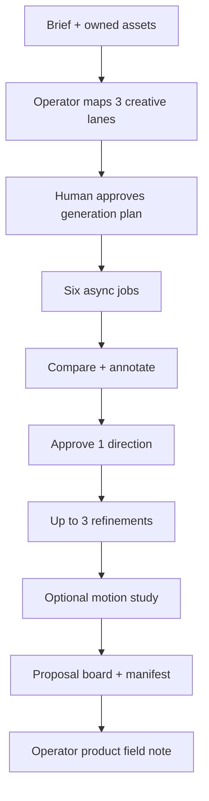

# Krea Field Studio

**Unofficial proof of work. Not affiliated with or endorsed by Krea.**

> Client brief to approved proposal — with the human still in charge of constraints, taste, and spend.

An unofficial Krea-powered field workflow: owned assets and preservation constraints become six controlled directions, a human-approved refinement, a proposal board, and an operator-authored product field note.

[Run the public replay](https://krea-field-studio.vercel.app/replay) · [CI](https://github.com/moisestech/krea-field-studio/actions) · [Live runbook](docs/LIVE_RUNBOOK.md)


Label on every public demo frame: **REPLAY**. Nothing is `LIVE` until a reviewed Krea artifact exists.

## Reviewer path (about 90 seconds)

1. Open [`/replay`](https://krea-field-studio.vercel.app/replay) — no login, no API key, no spend.
2. Map three lanes, approve the plan, watch exact Krea job states.
3. Compare without auto-rank, refine, open the proposal (limitations line), save the field note.
4. Optional: [`/failure`](https://krea-field-studio.vercel.app/failure) for cancel / failed job behavior.


## Status

| Surface                                            | State                        | Evidence                                                    |
| -------------------------------------------------- | ---------------------------- | ----------------------------------------------------------- |
| Replay golden path                                 | **REPLAY / live on the web** | Public `/replay`, Playwright, no credentials                |
| Failure / cancel / duplicate webhook               | **REPLAY / live on the web** | `/failure`, unit tests                                      |
| `KreaGenerationProvider` + Krea 2 Medium contracts | **Implemented**              | Source + [docs/MODEL_CONTRACTS.md](docs/MODEL_CONTRACTS.md) |
| Operator live record (`live:plan` / `live:record`) | **Implemented, local only**  | [docs/LIVE_RUNBOOK.md](docs/LIVE_RUNBOOK.md)                |
| Recorded API generation                            | **PLANNED**                  | No public `LIVE` claim until a reviewed manifest exists     |
| Postgres job ledger                                | **Schema only**              | Replay uses an in-memory ledger                             |

CI: lint, typecheck, unit tests, `live:plan`, build, Playwright.

## Demo

| Mode                    | URL                                                                     | Credentials              |
| ----------------------- | ----------------------------------------------------------------------- | ------------------------ |
| Replay (public default) | https://krea-field-studio.vercel.app/replay                             | None                     |
| Mock failure            | https://krea-field-studio.vercel.app/failure                            | None                     |
| Proposal                | https://krea-field-studio.vercel.app/proposal/replay-price-of-existence | None                     |
| Run trace               | https://krea-field-studio.vercel.app/trace/replay-price-of-existence    | None                     |
| Live                    | Local `npm run live:record` only                                        | Operator key + spend ack |

Custom domain `field-studio.moises.tech` is attached on Vercel and stays unused until DNS resolves.

## What this proves

Creative Lead work compressed: hear a brief, design a production workflow, use Krea with explicit control, keep a human in the approval seat, make async states legible, package a client board, and return a reproducible product field note.

## Workflow



## Architecture

Provider boundary: `submitImage`, `submitVideo`, `getJob`, `cancelJob`. UI never holds a provider object.

Persisted job states match Krea: `backlogged`, `queued`, `scheduled`, `processing`, `sampling`, `intermediate-complete`, `completed`, `failed`, `cancelled`.

The public webhook route exists, but the running replay ledger is in-memory. The recorded live batch uses local polling, not a claim of durable production webhooks.

## One live run (operator only)

Anonymous visitors cannot spend. After reviewing the dry-run:

```bash
npm run live:plan      # zero network
# confirm the six prompts and the under-$1 cap
KREA_LIVE_ACK=SPEND_UNDER_1_USD npm run live:record
```

Requires `KREA_API_KEY` in local `.env`. Writes a secret-free bundle to gitignored `.artifacts/`. Promotion of outputs is a separate human rights review. Motion is off.

## Local setup

```bash
npm install
npm run dev
```

Open `http://localhost:5173/replay`. No `.env` required.

```bash
npm run lint
npm run check
npm test
npm run live:plan
npm run build
npm run test:e2e
```

## Security, rights, limitations

- Krea tokens stay server-side / local env. They are never logged or written into artifacts.
- Artwork: Moises Sanabria, _Price of Existence_, 2024, artist-owned documentation.
- Site still: synthetic gallery drawing, not a real venue survey.
- Replay outputs are labeled **REPLAY** until a funded, reviewed run replaces selected frames.
- Communication and creative previsualization only. Not CAD, scale, structure, or permitting.
- No Krea endorsement is implied.

## Tests

```bash
npm test          # contracts, approval, webhooks, live-plan/record mocks
npm run test:e2e  # SVG fixtures + golden path through field note
```
