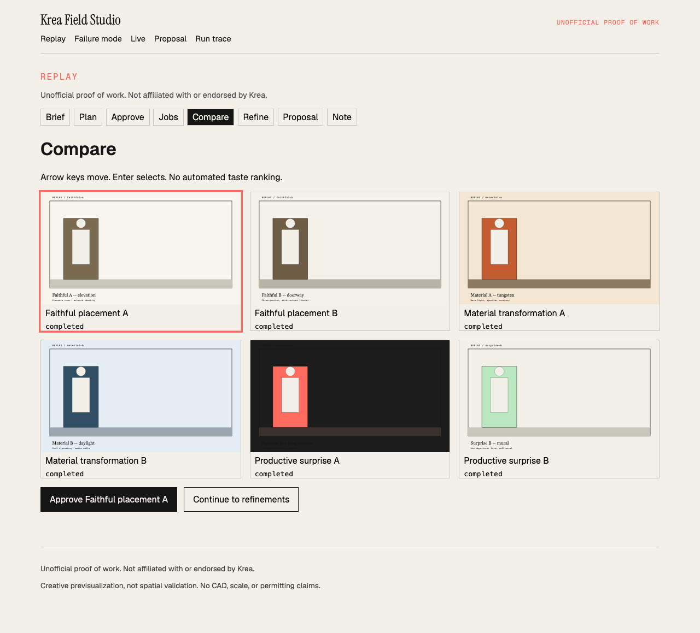
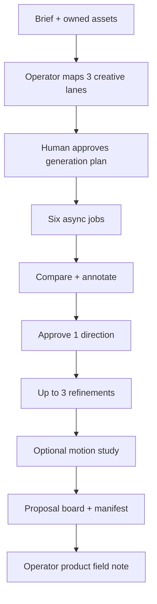
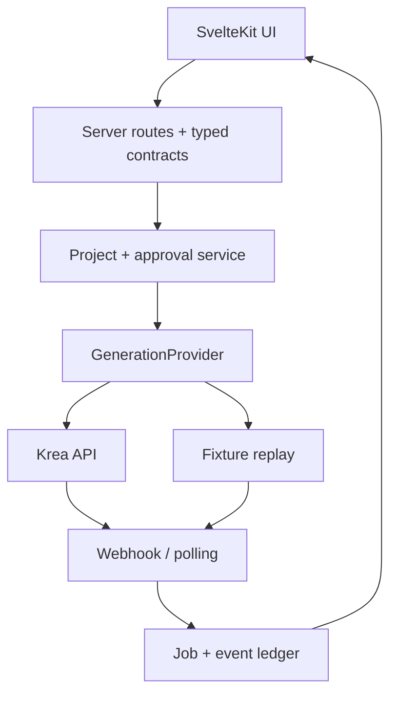

# Krea Field Studio

**Unofficial proof of work. Not affiliated with or endorsed by Krea.**

An unofficial Krea-powered field workflow that turns a creative client's site, artwork, references, and constraints into controlled visual directions, a human-approved refinement, a proposal board, and a structured product field note.

## 15–30 second loop

Brief + owned assets → three lanes → explicit approval → async jobs with exact Krea states → compare (no auto-rank) → proposal + field note.

Open `/` for the animated loop, or `/replay` to run it.


Replay compare view (Playwright, no credentials):



## Demo

| Mode                    | URL                                   | Credentials |
| ----------------------- | ------------------------------------- | ----------- |
| Replay (public default) | `/replay`                             | None        |
| Mock failure            | `/failure`                            | None        |
| Proposal board          | `/proposal/replay-price-of-existence` | None        |
| Run trace               | `/trace/replay-price-of-existence`    | None        |
| Live                    | server-only `KREA_API_KEY`            | Gated       |

Live demo: [`https://krea-field-studio.vercel.app`](https://krea-field-studio.vercel.app)  
Custom domain `field-studio.moises.tech` is attached on Vercel. Replay is the public path. Live spend is off until API balance is confirmed.

## What this proves for Krea

Creative Lead work compressed: understand a brief, design a production workflow, use Krea with explicit control, keep a human in the approval seat, make async states legible, package a client board, and return a reproducible product field note.

## Status

| Surface                                                                   | State                                                                                                 |
| ------------------------------------------------------------------------- | ----------------------------------------------------------------------------------------------------- |
| Replay golden path                                                        | **Live** in-repo                                                                                      |
| Mock failure, cancel, duplicate webhook                                   | **Live**                                                                                              |
| `KreaGenerationProvider` + documented Krea 2 Medium / Kling 2.5 contracts | **Implemented**, key + balance gated                                                                  |
| Recorded live API run                                                     | **Planned** until [API balance](https://www.krea.ai/app/api/) is funded                               |
| Postgres job ledger                                                       | Schema ready (`docker compose`); replay uses an in-memory ledger so the public demo needs no database |

## Workflow



## Architecture



Provider boundary: `submitImage`, `submitVideo`, `getJob`, `cancelJob`. UI never holds a provider object.

Persisted job states match Krea: `backlogged`, `queued`, `scheduled`, `processing`, `sampling`, `intermediate-complete`, `completed`, `failed`, `cancelled`.

## Failure behavior

- `/failure` scripts one failed job.
- Queued/processing jobs expose **Cancel**.
- `POST /api/webhooks/krea` rejects unknown `job_id`.
- Duplicate terminal deliveries are recorded and treated as no-ops.
- Partial completion still yields a reviewable set.
- Empty Krea API balance returns HTTP 402 with an explicit wallet message. Failed/cancelled jobs are not billed.

## Local setup

Replay first:

```bash
npm install
npm run dev
```

Open `http://localhost:5173/replay`. No `.env` required.

Live second:

```bash
cp .env.example .env
# set KREA_API_KEY from https://www.krea.ai/settings/api-tokens
# confirm USD API balance at https://www.krea.ai/app/api/  (separate from app compute units)
docker compose up -d   # optional Postgres
npm run dev
```

Model contracts: [`docs/MODEL_CONTRACTS.md`](docs/MODEL_CONTRACTS.md). Schemas were copied from public OpenAPI on 2026-08-16 (Krea MCP was not connected in the authoring session).

## Security, rights, privacy, limitations

- Krea tokens stay server-side. They are never logged into fixtures or client bundles.
- Artwork still: Moises Sanabria, _Price of Existence_, 2024, artist-owned documentation.
- Site still: synthetic gallery drawing, not a real venue survey.
- Replay outputs are labeled **REPLAY** fixtures, not a recorded Krea live run, until a funded run replaces them.
- This tool is communication and creative previsualization. It does not claim CAD accuracy, structural feasibility, scale, or permitting.
- No Krea endorsement is implied.

## Visual asset index

| File                                         | License / rights                                      |
| -------------------------------------------- | ----------------------------------------------------- |
| `static/fixtures/site-gallery.svg`           | Original synthetic drawing for this demo              |
| `static/fixtures/out/*.svg`                  | Original replay boards, labeled REPLAY                |
| Cloudinary `price_of_existence_wideshot.png` | Artist-owned; used with permission of Moises Sanabria |

## Tests

```bash
npm test          # vitest: contracts, approval gate, webhook idempotency
npm run test:e2e  # Playwright golden path
```
